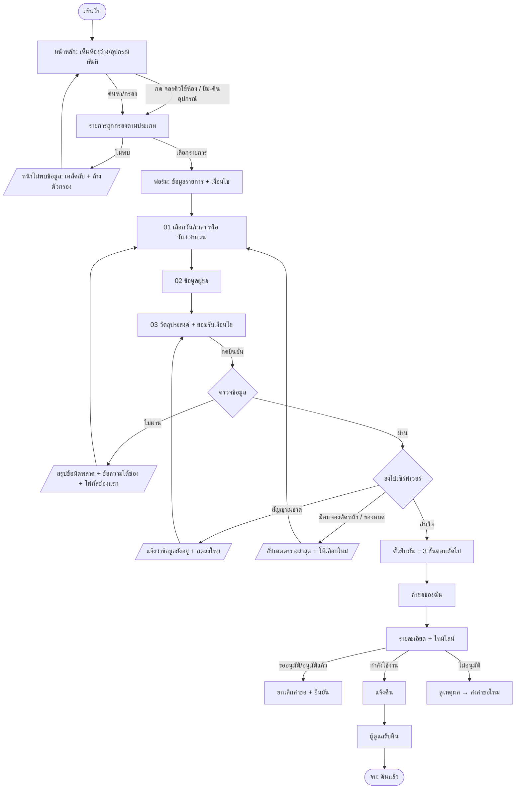

# LabQ — เอกสารการออกแบบ

## 1. แผนผังเส้นทางการใช้งาน (User Flow)

GitHub แสดงแผนภาพนี้ให้อัตโนมัติ (Mermaid)

### จุดที่อาจเกิดปัญหา และวิธีแก้ที่ใส่ไว้
| จุดเสี่ยง | วิธีรับมือในระบบ |
|---|---|
| ไม่รู้ว่าห้องไหนว่าง | หน้าหลักสรุป “ว่างวันนี้ N ช่วง” ทุกการ์ด + กรอง “เฉพาะที่ว่าง” |
| กรอกรหัสนักศึกษา/เบอร์ผิดรูปแบบ | ตัวอย่างใน placeholder + คำแนะนำใต้ช่อง + ข้อความแก้ไขเฉพาะจุด |
| เลือกเวลาที่ถูกจองไปแล้ว | ช่วงที่เต็มกดไม่ได้ (ลายทแยง + ข้อความ “เต็ม”) และฐานข้อมูลกันซ้อนเวลาอีกชั้น |
| มีคนจองตัดหน้าระหว่างกรอก | แจ้งเตือน + โหลดตารางใหม่อัตโนมัติ ไม่ต้องกรอกใหม่ |
| ยืมเกินจำนวน/เกินวัน | ปุ่ม +/- ถูกจำกัดตามของคงเหลือและวันสูงสุด ตรวจซ้ำที่เซิร์ฟเวอร์ |
| กดยกเลิกพลาด | ต้องยืนยันผ่านกล่องข้อความ ปุ่มยกเลิกเป็นสีแดงแยกจากปุ่มหลัก |
| ผู้ดูแลกดอนุมัติผิดคำขอ | ทุกการกระทำมีกล่องยืนยันที่สรุปชื่อ/รายการ/เวลา การปฏิเสธต้องระบุเหตุผล |
| สัญญาณขาด | แถบแจ้งเตือนด้านบน + หน้าลองใหม่ + ข้อมูลฟอร์มไม่หาย |

## 2. หน้าจอที่ออกแบบ (ทุกหน้าใช้ layout เดียวกัน ปรับตามจอ)

| # | หน้าจอ | เส้นทาง |
|---|---|---|
| 1 | หน้าหลักเลือกบริการและตรวจสอบความพร้อม | `#/` |
| 2 | กรอกรายละเอียดการจอง/ขอยืม (+ หน้าส่งสำเร็จ) | `#/book/:id`, `#/done/:id` |
| 3 | คำขอของฉัน + รายละเอียดและปุ่มตามสถานะ | `#/my`, `#/my/:id` |
| 4 | สถานะพิเศษ: ไม่พบข้อมูล · กรอกไม่ถูกต้อง · โหลด/ออฟไลน์ | `#/states` |
| + | มุมมองผู้ดูแล (เน้นจอคอมพิวเตอร์) | `#/admin` |

มือถือ: แท็บบาร์ด้านล่าง + ปุ่มยืนยันติดขอบล่างให้นิ้วโป้งเอื้อมถึง
คอมพิวเตอร์: เมนูบนแถบหัว + ฟอร์มสองคอลัมน์ (ข้อมูลรายการ/ปุ่มยืนยันติดข้าง ฟอร์มอยู่ขวา) + ตารางงานผู้ดูแล

> วิธีเก็บภาพหน้าจอส่งอาจารย์: เปิดเว็บ → F12 → Toggle device toolbar เลือก iPhone 12 และ 1440px แล้วจับภาพแต่ละเส้นทาง (ดูหน้าสถานะพิเศษได้ที่ `#/states/empty`, `#/states/invalid`, `#/states/loading`)

## 3. เหตุผลการออกแบบ

**แนวคิดภาพ “สมุดแล็บ × ตั๋วคิว”** — พื้นกระดาษกริดสื่อถึงสมุดจดการทดลอง การ์ดรายการเป็นตั๋วที่มีรอยปรุกลางและรอยบากซ้ายขวา สื่อความหมายตรงตัวว่า “จองคิว” ปุ่มมีเงาแข็งแล้ว “ยุบ” เมื่อกด เป็นสัญญาณยืนยันว่าระบบรับคำสั่งแล้ว

**การวางตำแหน่ง**
- หน้าหลักมี 2 ทางลัดใหญ่ (จองห้อง / ยืมอุปกรณ์) อยู่ใต้หัวข้อทันที เพราะเป็นงานหลัก 90% ของนักศึกษา ตัวเลข “ห้องว่างวันนี้ / อุปกรณ์พร้อมยืม” อยู่บนกระดานสีเข้มให้สายตาไปถึงโดยไม่ต้องเลื่อน
- ฟอร์มแบ่ง 3 ส่วนมีเลข 01–03 (เวลา → ข้อมูลผู้ขอ → วัตถุประสงค์) เพื่อลดภาระความคิดต่อหน้า เงื่อนไข/จำนวนคงเหลืออยู่ก่อนฟอร์มเพื่อให้รู้ข้อจำกัดก่อนกรอก
- ปุ่มยืนยันอยู่ติดล่าง (มือถือ) ส่วนปุ่ม “กลับ” เป็นลิงก์ข้อความอยู่มุมบนซ้าย ไกลกันจนกดสลับไม่ได้
- หน้าผู้ดูแลเป็นแถวตารางที่ปุ่ม “อนุมัติ/ไม่อนุมัติ” อยู่ใต้ป้ายสถานะ และเปลี่ยนปุ่มตามสถานะ (รออนุมัติ → ส่งมอบ → รับคืน) กดได้เฉพาะขั้นตอนที่ถูกต้อง

**สีและตัวอักษร**
- สัดส่วนประมาณ 60 / 30 / 10: กระดาษครีม (พื้น) / หมึกกรมท่า (ตัวอักษร เส้นขอบ) / ส้ม+เหลือง (ปุ่มหลักและจุดเน้น)
- ตัวอักษรกรมท่าบนครีมมีอัตราส่วนความคมชัดสูงกว่า 12:1 ข้อความบนปุ่มส้มใช้สีกรมท่า (ไม่ใช่ขาว) เพื่อให้อ่านชัดกลางแดด
- ไม่ใช้สีอย่างเดียว: ทุกสถานะมี **ไอคอน + ข้อความ + ลักษณะขอบ** (เช่น ยกเลิก = ขอบเส้นประ, ช่องเต็ม = ลายทแยง, ช่องผิด = ขอบประแดง + ไอคอนเตือน)
- ฟอนต์ Anuphan (หัวข้อ), IBM Plex Sans Thai (เนื้อหา), IBM Plex Mono (เวลา/รหัส) ขนาดเป็นระบบ 6 ระดับ (13/15/16/19/24/ไม่เกิน 48px) บรรทัดสูง 1.7 เพราะภาษาไทยมีสระบน-ล่าง

**คำอธิบายกำกับ**: ทุกช่องมี label + ตัวอย่าง + คำแนะนำใต้ช่อง ข้อความผิดพลาดใช้น้ำเสียงสุภาพและบอกวิธีแก้ (“เช่น 6612345678 ไม่ต้องใส่ขีด”) แทนการบอกแค่ว่า “ไม่ถูกต้อง”

**การเคลื่อนไหว (ไม่เกิน 0.4 วินาที)**
- หน้าเลื่อนขึ้น 0.3 วิ และการ์ดทยอยปรากฏ เพื่อบอกว่าเปลี่ยนหน้าแล้ว
- ช่องเวลาที่เลือก “เด้ง” เล็กน้อย / ปุ่มยุบ / ตราประทับ “ส่งแล้ว” ตกลงมาบนตั๋ว เพื่อยืนยันว่าระบบรับคำสั่งแล้ว
- โครงโหลดแบบ shimmer และสปินเนอร์ในปุ่มระหว่างส่ง ให้รู้ว่าเว็บไม่ค้าง
- ผู้ที่ตั้งค่าลดการเคลื่อนไหวในระบบ จะไม่เห็นแอนิเมชันเลย (`prefers-reduced-motion`)

**การเข้าถึง**: ลิงก์ “ข้ามไปเนื้อหา”, ใช้แป้น Tab ได้ตามลำดับ, วงโฟกัสสีน้ำเงินหนา 3px, ปุ่มสัมผัส ≥ 44px, `aria-label`/`aria-live` กำกับช่วงเวลา จำนวนคงเหลือ และข้อความแจ้งเตือน, กล่องยืนยันใช้ `<dialog>` ที่จัดการโฟกัสให้

## 4. การตัดสินใจที่ได้จากการตรวจทานตัวต้นแบบ

ส่วนนี้มาจากการไล่ตรวจเองตามสถานการณ์จำลอง (heuristic review) **ยังไม่ใช่ผลทดสอบกับผู้ใช้จริง** ตารางข้อ 5 ไว้ให้เติมหลังทดสอบจริง และควรอัปเดตส่วนนี้ตามผลที่ได้

- ช่องเวลา: เลือกวิธี “แตะช่วงเดียวหรือแตะต่อเนื่อง” แทนการให้เลือกเวลาเริ่ม–จบแยกกัน เพราะขั้นตอนน้อยกว่าบนมือถือ และมีสรุปเวลาที่เลือกติดปุ่มยืนยันตลอด
- ปุ่มยืนยัน: ติดขอบล่างบนมือถือ เพื่อไม่ต้องเลื่อนสุดฟอร์ม
- ข้อผิดพลาด: มี “สรุปข้อผิดพลาด” ด้านบนพร้อมลิงก์กระโดดไปช่องที่ผิด เพราะฟอร์มยาวบนมือถือทำให้ไม่เห็นข้อความใต้ช่อง
- ช่องที่เต็ม: ใช้ลายทแยงและขีดฆ่าเวลา เพื่อแยกจาก “ผ่านไปแล้ว” โดยไม่พึ่งสีเทาอย่างเดียว
- สีปุ่มหลัก: ใช้ตัวอักษรกรมท่าบนปุ่มส้ม ไม่ใช้ขาว เพราะความคมชัดของขาวบนส้มไม่ผ่านเกณฑ์
- มีคนจองตัดหน้า: โหลดตารางใหม่และล้างช่วงที่เลือกอัตโนมัติ พร้อมแจ้งเหตุผล

## 5. ตารางบันทึกผลทดสอบกับผู้ใช้จริง (เติมเอง)

| ผู้ทดสอบ | งานที่ให้ทำ | ทำสำเร็จ? | เวลา | จุดติดขัด | สิ่งที่ปรับ |
|---|---|---|---|---|---|
| คน 1 (มือถือ) | จองห้อง E-301 พรุ่งนี้บ่ายสอง 2 ชม. | | | | |
| คน 2 (มือถือ) | ยืม Arduino 3 วัน แล้วแจ้งคืน | | | | |
| คน 3 (มือถือ) | ดูว่าทำไมคำขอถูกปฏิเสธ แล้วส่งใหม่ | | | | |
| ผู้ดูแล (คอม) | อนุมัติ 1 รายการ ปฏิเสธ 1 รายการ รับคืน 1 รายการ | | | | |

แนะนำให้ทดสอบ 3–5 คน ใช้การให้พูดออกเสียงขณะทำ (think-aloud) และจับเวลา
